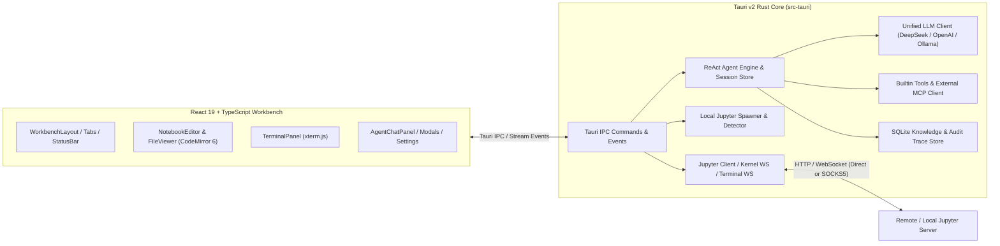

# LabNexus

**LabNexus** 是一款基于 **Tauri v2 (Rust)** 与 **React 19 (TypeScript)** 构建的原生桌面端远程 JupyterLab 客户端与科学计算 AI Agent 工作台。它专为连接远程算力集群、内网 GPU 服务器以及本地科学计算环境而设计，将多标签页 Notebook/代码编辑、SSH/SOCKS5 隧道穿透、远程终端与支持 MCP 协议的 ReAct 智能体深度融合在轻量级原生桌面应用中。

> **Current Version**: `v0.4.0`

---

## 核心特性 (Key Features)

### 1. 混合 Jupyter 连接与内网穿透 (Hybrid Connectivity & Proxy Tunneling)
- **远程服务器管理**：支持连接标准 Jupyter Server（Token 认证）与 JupyterHub / TLJH（用户名 + 密码登录），支持一键重连、断开与服务重启。
- **全链路 SOCKS5 / SSH `-D` 代理支持**：内置针对 `ssh -D` 动态端口转发的原生支持，REST API、Kernel WebSocket（含 TLS over SOCKS5）与 Terminal WebSocket 全链路走代理穿透内网计算节点。
- **本地 Jupyter 自动检测与托管**：自动探测本机 `jupyter lab` / `jupyter notebook` 环境，支持一键以随机空闲端口启动本地服务，并在断开或退出时自动回收进程。
- **系统级凭据安全存储**：在 macOS 下自动将远程服务器 Token/密码与 AI API Key 托管至系统钥匙串（**macOS Keychain**），落盘配置文件自动脱敏并限制为 `0600` 权限。

### 2. 多标签页 IDE 工作台 (Multi-Tab Scientific Workbench)
- **交互式 Notebook 编辑器 (`.ipynb`)**：
  - 基于 **CodeMirror 6** 的 Python / Markdown 语法高亮编辑器；
  - 完整支持 `stream`、`execute_result`、`display_data`（PNG / JPEG / SVG 图像、HTML 表格、LaTeX 公式）与 ANSI 错误堆栈渲染；
  - 长输出自动折叠（展开全部 / 一键复制输出）、单元格增删/上下移动/类型切换、单步运行、全部运行、中断/重启内核、一键清除所有输出；
  - 自动解析 Markdown 标题生成 **目录大纲（Table of Contents）**，点击即可平滑定位至目标单元格。
- **多格式文件查看与编辑**：
  - **代码与配置文件**：支持 `.py`、`.sh`、`.yaml`、`.toml`、`.txt` 等文本文件的在线编辑与 `Cmd/Ctrl + S` 保存、自动换行切换；
  - **JSON 工具**：支持在线编辑、语法校验与一键格式化（Format JSON）；
  - **Markdown 文档**：支持源码编辑与渲染预览双模式切换；
  - **数据表格 (`.csv` / `.tsv`)**：自动解析分隔符并以冻结表头的结构化数据表预览，同时支持切换查看原始文本；
  - **远程图像查看器**：通过后端二进制读取与 Base64 Data URL 转换，支持在 SOCKS5 代理或鉴权环境下直接预览远程服务器上的 `.png` / `.jpg` / `.svg` / `.webp` / `.gif` 图像。
- **远程文件资源管理器**：支持目录懒加载、内联新建 Notebook / 空文件 / 文件夹、内联重命名与二次确认删除。
- **远程终端 (`xterm.js`)**：支持多终端会话并发管理、窗口尺寸自适应（`ResizeObserver`）以及随工作台明暗主题实时同步终端配色。

### 3. ReAct 科学计算 AI Agent 与 MCP 生态
- **混合大模型策略 (Hybrid LLM Strategy)**：
  - **远程 API（OpenAI / DeepSeek 兼容）**：原生适配新一代混合推理模型（如 `deepseek-flash` / `deepseek-4.1-flash`、`deepseek-reasoner`、`o3` / `gpt-4.1` 等）：
    - 支持配置 **思考模式（`thinking_mode`: `auto` / `enabled` / `disabled`）** 与 **思考深度（`reasoning_effort`: `low` / `medium` / `high` / `max`）**；
    - 思考模式激活时自动省略无效的 `temperature` 参数并校准 `top_p` 范围；
    - 严格遵循 DeepSeek 多轮 Tool Call 协议，在携带 `tools` 的多轮对话中自动保留并回传 `reasoning_content`；
    - 实时流式推送思维链（`Thinking` 折叠面板）与最终回答。
  - **本地模型（Ollama / llama.cpp）**：支持本地模型推理、工具调用能力自适应降级，以及远程/本地服务商之间的 **指数退避重试 + 熔断器（Circuit Breaker）自动容错切换**。
- **内置科学计算工具与外部 MCP 扩展**：
  - 内置 Notebook 单元格读写、远程内核代码执行、远程文件读写等工具；
  - 支持挂载外部 **MCP (Model Context Protocol)** 服务器（支持 `stdio` 与 `Streamable HTTP` 传输协议），保存配置时自动连接并发现工具。
- **分级安全护栏 (Risk-Aware Tool Approval)**：
  - 工具调用按风险等级（`safe` / `compute` / `mutation` / `sensitive` / `high` / `critical`）分类；
  - 支持只读安全工具自动放行，写操作/代码执行/外部 MCP 工具支持「单次允许」或「本次会话允许」授权；
  - 支持随时取消正在运行的 Agent 任务，并可一键联动向远程 Jupyter 内核发送中断信号（`Stop Agent & Interrupt Kernel`）。
- **科学工作流技能 (Skills)、领域知识库 (Knowledge Base) 与审计追踪 (Traces)**：
  - 内置科研数据分析、代码调试等结构化工作流技能（支持 `/skill_id` 快捷调用）；
  - 内置基于 SQLite 的本地领域知识库（支持中英文分词检索与可信度分级注入）；
  - 完整记录每次 ReAct 执行的步骤时间线、输入/输出 Token 消耗、思维链字符数与耗时，并对日志中的敏感凭据自动脱敏。

### 4. 现代化 UI、主题与双语国际化
- **统一视觉语言**：全工作台采用 `lucide-react` 矢量图标体系、可折叠手风琴侧边栏（Accordion）与底部实时内核/单元格遥测状态栏。
- **双主题与快捷键自定义**：内置 **JupyterLab Light（浅色）** 与 **JupyterLab Dark（深色）** 主题，支持自定义运行单元格快捷键。
- **中英文双语界面 (`zh-CN` / `en`)**：在 **设置 → 全局设置 → 界面语言（Settings → Global Settings → Interface language）** 中可即时切换简体中文或 English，首次启动自动匹配系统语言。

---

## 系统架构 (Architecture)



### 目录结构 (Project Structure)

```text
labnexus/
├── src/                        # 前端源码 (React 19 + TypeScript + Tailwind CSS v4)
│   ├── components/
│   │   ├── agent/              # ReAct AI 助手面板、工具授权弹窗、知识库、技能与执行追踪查看器
│   │   ├── common/             # 顶部多标签栏 (WorkbenchTabs)、状态栏 (StatusBar)、欢迎页
│   │   ├── explorer/           # 服务器连接面板、本地 Jupyter 面板、远程文件资源管理器
│   │   ├── notebook/           # Notebook 编辑器、单元格组件、输出渲染器、大纲目录
│   │   ├── settings/           # 全局设置与 AI 模型/MCP/容错配置弹窗
│   │   ├── terminal/           # 远程终端会话选择器与 xterm.js 终端面板
│   │   └── viewer/             # 多格式文件查看与编辑器 (Code/JSON/Markdown/CSV/Image)
│   ├── hooks/                  # Jupyter、Kernel、Terminal、Agent 状态管理 Hooks
│   ├── i18n/                   # 中英文国际化字典与响应式语言切换
│   ├── layouts/                # IDE 主工作台布局 (WorkbenchLayout)
│   └── services/               # Tauri IPC 通信封装与全局设置持久化
└── src-tauri/                  # Rust 后端源码 (Tauri v2)
    └── src/
        ├── agent/              # ReAct 引擎、LLM 客户端、配置管理、MCP 协议、知识库与审计日志
        ├── jupyter/            # Jupyter REST 客户端、Kernel/Terminal WebSocket、本地服务管理
        └── commands/           # Tauri IPC 命令导出
```

---

## AI 模型配置指南 (以 DeepSeek 4.1 Flash / V4 为例)

打开左下角 **设置 (Settings) → AI 配置 (AI Configuration)**：

1. **服务商与模型 (Provider & Models)**：
   - **Base URL**：`https://api.deepseek.com`（或任意 OpenAI 兼容接口地址）
   - **Chat Model**：`deepseek-flash`（或 `deepseek-4.1-flash`、`deepseek-chat`、`gpt-4.1`）
   - **Reasoning Model**：`deepseek-reasoner`（当使用传统非 Flash 模型且开启思考模式时可作为专用推理模型）
   - **思考模式 (Thinking Mode)**：
     - `自动 (Auto)`：根据模型特性自动决定是否启用内置思维链；
     - `开启 (Enabled)`：显式向接口发送 `"thinking": { "type": "enabled" }`，开启深度思考并自动省略无效的 `temperature` 参数；
     - `关闭 (Disabled)`：显式发送 `"thinking": { "type": "disabled" }`，适合需要极速响应的简单任务。
   - **思考深度 (Reasoning Effort)**：支持 `low`（工具调用循环更快）、`medium`（默认均衡）、`high`（深度分析）、`max`（最大思维链预算）。
2. **上下文与记忆 (Context & Memory)**：
   - 默认远程上下文窗口为 `128,000` Tokens（最高可配置至 `2,000,000` Tokens），默认最大输出预算为 `8,192` Tokens，为包含思维链（`reasoning_content`）与工具调用参数的响应预留充足空间。

---

## 开发与构建 (Development & Build)

### 环境要求 (Prerequisites)
- **Node.js** `>= 20` & **npm**
- **Rust** `>= 1.77` & **Cargo**
- Tauri v2 平台依赖（macOS Xcode Command Line Tools / Linux WebKitGTK / Windows WebView2）

### 常用命令 (Commands)

```bash
# 1. 安装前端依赖
npm install

# 2. 启动桌面端开发模式 (Vite + Tauri Dev)
npm run tauri dev

# 3. 仅运行前端类型检查与生产构建
npm run build

# 4. 运行 Rust 后端单元测试
cargo test --manifest-path src-tauri/Cargo.toml

# 5. 构建可分发的原生桌面安装包 (.dmg / .app / .msi / .deb)
npm run tauri build
```
