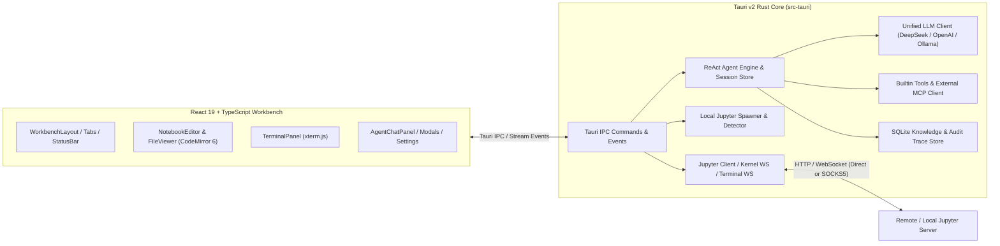

# LabNexus

**LabNexus** 是一款基于 **Tauri v2 (Rust)** 与 **React 19 (TypeScript)** 构建的原生桌面端远程 JupyterLab 客户端与科学计算 AI Agent 工作台。它专为连接远程算力集群、内网 GPU 服务器以及本地科学计算环境而设计，将多标签页 Notebook/代码编辑、SSH/SOCKS5 隧道穿透、远程终端与支持 MCP 协议的 ReAct 智能体深度融合在轻量级原生桌面应用中。

> **Current Version**: `v0.5.0`

### v0.5.0 更新

- AI 设置默认使用 `deepseek-flash` 和 Responses API，统一模型与思考模式配置，完善流式输出和多轮工具调用。
- 新增 ChatGPT 登录与多账号管理，可通过符合条件的订阅使用授权模型，并查看用量入口。
- 新增 AI 独立代理，API Key 与 ChatGPT 分别配置系统代理、手动代理或直连，支持 HTTP / HTTPS / SOCKS5 / SOCKS5H 和连接测试。
- 详细变更与使用说明见 [v0.5.0 版本说明](docs/releases/v0.5.0.md) 及下方 AI 配置章节。

---

## 核心特性 (Key Features)

### 1. 混合 Jupyter 连接与内网穿透 (Hybrid Connectivity & Proxy Tunneling)
- **远程服务器管理**：支持连接标准 Jupyter Server（Token 认证）与 JupyterHub / TLJH（用户名 + 密码登录），支持一键重连、断开与服务重启。
- **全链路 SOCKS5 / SSH `-D` 代理支持**：内置针对 `ssh -D` 动态端口转发的原生支持，REST API、Kernel WebSocket（含 TLS over SOCKS5）与 Terminal WebSocket 全链路走代理穿透内网计算节点。
- **本地 Jupyter 自动检测与托管**：自动探测本机 `jupyter lab` / `jupyter notebook` 环境，支持一键以随机空闲端口启动本地服务，并在断开或退出时自动回收进程。
- **系统级凭据安全存储**：在 macOS 下自动将远程服务器 Token/密码与 AI API Key 托管至系统钥匙串（**macOS Keychain**），落盘配置文件自动脱敏并限制为 `0600` 权限。

### 2. 多标签页 IDE 工作台 (Multi-Tab Scientific Workbench)
- **交互式 Notebook 编辑器 (`.ipynb`)**：
  - 基于 **CodeMirror 6** 的 Python / Markdown 语法高亮编辑器；
  - 完整支持 `stream`、`execute_result`、`display_data`（PNG / JPEG / SVG 图像、HTML 表格、LaTeX 公式）与 ANSI 错误堆栈渲染；
  - 长输出自动折叠（展开全部 / 一键复制输出）、单元格增删/上下移动/类型切换、单步运行、全部运行、中断/重启内核、一键清除所有输出；
  - 自动解析 Markdown 标题生成 **目录大纲（Table of Contents）**，点击即可平滑定位至目标单元格。
- **多格式文件查看与编辑**：
  - **代码与配置文件**：支持 `.py`、`.sh`、`.yaml`、`.toml`、`.txt` 等文本文件的在线编辑与 `Cmd/Ctrl + S` 保存、自动换行切换；
  - **JSON 工具**：支持在线编辑、语法校验与一键格式化（Format JSON）；
  - **Markdown 文档**：支持源码编辑与渲染预览双模式切换；
  - **数据表格 (`.csv` / `.tsv`)**：自动解析分隔符并以冻结表头的结构化数据表预览，同时支持切换查看原始文本；
  - **远程图像查看器**：通过后端二进制读取与 Base64 Data URL 转换，支持在 SOCKS5 代理或鉴权环境下直接预览远程服务器上的 `.png` / `.jpg` / `.svg` / `.webp` / `.gif` 图像。
- **远程文件资源管理器**：支持目录懒加载、内联新建 Notebook / 空文件 / 文件夹、内联重命名与二次确认删除。
- **远程终端 (`xterm.js`)**：支持多终端会话并发管理、窗口尺寸自适应（`ResizeObserver`）以及随工作台明暗主题实时同步终端配色。

### 3. ReAct 科学计算 AI Agent 与 MCP 生态
- **混合大模型策略 (Hybrid LLM Strategy)**：
  - **远程 API（OpenAI / DeepSeek 兼容）**：默认使用 **Responses API**，原生支持 `deepseek-flash`（DeepSeek V4.1 Flash）与 `gpt-6.1-sol`：
    - 统一模型字段，按模型能力设置思考模式和深度；保留 Chat Completions 供旧服务兼容。
    - 适配文本、推理摘要 / DeepSeek 推理文本、并行函数调用和 Token 用量的流式事件。
    - 本地保存并回传完整 Responses 输出条目，包括加密推理与消息 phase，维持工具调用多轮上下文；按模型和接口地址隔离回传。
    - 使用 `store: false` 和完整本地历史实现无状态接续；失败、截断或缺失完成事件时不会执行部分工具调用。
  - **本地模型（Ollama / llama.cpp）**：支持本地模型推理、工具调用能力自适应降级，以及远程/本地服务商之间的 **指数退避重试 + 熔断器（Circuit Breaker）自动容错切换**。
- **内置科学计算工具与外部 MCP 扩展**：
  - 内置 Notebook 单元格读写、远程内核代码执行、远程文件读写等工具；
  - 支持挂载外部 **MCP (Model Context Protocol)** 服务器（支持 `stdio` 与 `Streamable HTTP` 传输协议），保存配置时自动连接并发现工具。
- **分级安全护栏 (Risk-Aware Tool Approval)**：
  - 工具调用按风险等级（`safe` / `compute` / `mutation` / `sensitive` / `high` / `critical`）分类；
  - 支持只读安全工具自动放行，写操作/代码执行/外部 MCP 工具支持「单次允许」或「本次会话允许」授权；
  - 支持随时取消正在运行的 Agent 任务，并可一键联动向远程 Jupyter 内核发送中断信号（`Stop Agent & Interrupt Kernel`）。
- **科学工作流技能 (Skills)、领域知识库 (Knowledge Base) 与审计追踪 (Traces)**：
  - 内置科研数据分析、代码调试等结构化工作流技能（支持 `/skill_id` 快捷调用）；
  - 内置基于 SQLite 的本地领域知识库（支持中英文分词检索与可信度分级注入）；
  - 完整记录每次 ReAct 执行的步骤时间线、输入/输出 Token 消耗、思维链字符数与耗时，并对日志中的敏感凭据自动脱敏。

### 4. 现代化 UI、主题与双语国际化
- **统一视觉语言**：全工作台采用 `lucide-react` 矢量图标体系、可折叠手风琴侧边栏（Accordion）与底部实时内核/单元格遥测状态栏。
- **双主题与快捷键自定义**：内置 **JupyterLab Light（浅色）** 与 **JupyterLab Dark（深色）** 主题，支持自定义运行单元格快捷键。
- **中英文双语界面 (`zh-CN` / `en`)**：在 **设置 → 全局设置 → 界面语言（Settings → Global Settings → Interface language）** 中可即时切换简体中文或 English，首次启动自动匹配系统语言。

---

## 系统架构 (Architecture)



### 目录结构 (Project Structure)

```text
labnexus/
├── src/                        # 前端源码 (React 19 + TypeScript + Tailwind CSS v4)
│   ├── components/
│   │   ├── agent/              # ReAct AI 助手面板、工具授权弹窗、知识库、技能与执行追踪查看器
│   │   ├── common/             # 顶部多标签栏 (WorkbenchTabs)、状态栏 (StatusBar)、欢迎页
│   │   ├── explorer/           # 服务器连接面板、本地 Jupyter 面板、远程文件资源管理器
│   │   ├── notebook/           # Notebook 编辑器、单元格组件、输出渲染器、大纲目录
│   │   ├── settings/           # 全局设置与 AI 模型/MCP/容错配置弹窗
│   │   ├── terminal/           # 远程终端会话选择器与 xterm.js 终端面板
│   │   └── viewer/             # 多格式文件查看与编辑器 (Code/JSON/Markdown/CSV/Image)
│   ├── hooks/                  # Jupyter、Kernel、Terminal、Agent 状态管理 Hooks
│   ├── i18n/                   # 中英文国际化字典与响应式语言切换
│   ├── layouts/                # IDE 主工作台布局 (WorkbenchLayout)
│   └── services/               # Tauri IPC 通信封装与全局设置持久化
└── src-tauri/                  # Rust 后端源码 (Tauri v2)
    └── src/
        ├── agent/              # ReAct 引擎、LLM 客户端、配置管理、MCP 协议、知识库与审计日志
        ├── jupyter/            # Jupyter REST 客户端、Kernel/Terminal WebSocket、本地服务管理
        └── commands/           # Tauri IPC 命令导出
```

---

## AI 模型配置指南 (以 DeepSeek 4.1 Flash / V4 为例)

打开左下角 **设置 (Settings) → AI 配置 (AI Configuration)**：

1. **服务商与模型 (Provider & Models)**：
   - **认证方式**：默认 API Key + `deepseek-flash`。也可选择 **ChatGPT 订阅**，点击 **Continue with ChatGPT** 在系统浏览器中登录并授权，选择该账号可用模型后保存。
   - **ChatGPT 订阅**：针对符合条件的本地应用和 Plus / Pro 账号，通过官方 OAuth 使用订阅额度或可用积分。支持多个账号、Token 自动续期、退出及用量管理；不会读取 ChatGPT 历史对话，也不会在订阅额度不足时转用付费 API Key。模型和额度以实际账号、工作区政策为准。
   - 登录凭据仅存于本机 `~/.labnexus/config/chatgpt/`，Unix 下目录权限 `0700`、文件权限 `0600`，不通过前端 IPC 返回。退出会尝试撤销续期凭据；远程撤销无法确认时会显示提示。
   - 订阅路由固定使用官方 Responses 地址，按其限制省略输出上限与采样参数；本地输出预算仅用于预留上下文。
   - **API 协议**：默认 `Responses API`，旧配置缺少协议字段时也采用 Responses。仅兼容旧服务时选择 `Chat Completions`，不会在请求失败后自动更换协议。
   - **模型预设**：点击 **DeepSeek V4.1 Flash** 或 **GPT-6.1 Sol**，填入对应服务商 API Key 后保存。切换服务商会清空旧 Key 输入，防止发给错误服务商。预设超时为 300 秒，输出预算为 65,536 Tokens。
   - **Base URL / 模型**：DeepSeek 为 `https://api.deepseek.com` / `deepseek-flash`；OpenAI 为 `https://api.openai.com/v1` / `gpt-6.1-sol`。也可填写兼容网关地址；完整 `/responses` 或旧 `/chat/completions` 地址会按选定协议规范化。
   - **思考设置**：Responses 通过 `reasoning.effort` 控制思考。同一模型完成对话和推理，只有 Chat Completions 的高级兼容选项保留独立推理模型。
     - Flash：支持 `low / high / max`，默认 `high`；关闭思考时发送 `none`。旧配置 `medium / xhigh` 按 `high` 发送。思考模式省略 `temperature`，`top_p` 限于 `0.95–1.00`；非思考模式使用 `temperature`（`0–2`），省略固定为 `1` 的 `top_p`。
     - GPT-6.1 Sol：支持 `low / medium / high / xhigh / max`，预设为 `medium`；不能关闭推理，需要更快响应时选择 `low`。工具调用必须使用 Responses API。
2. **AI 网络代理 (AI proxy)**：
   - API Key 远程模型与 ChatGPT 订阅分别配置，均支持 **跟随系统（默认） / 手动代理 / 直连**。例如可将 DeepSeek 设为直连、ChatGPT 设为手动代理。
   - 手动代理支持 `http://`、`https://`、`socks5://`、`socks5h://`，如 `http://127.0.0.1:7890` 或 `socks5h://127.0.0.1:7891`；实际端口以 VPN 客户端为准。SOCKS5H 通过代理解析域名，地址中不支持用户名密码。
   - ChatGPT 代理统一覆盖 OAuth 令牌交换、JWKS 身份校验、续期、撤销、模型目录和 Responses 推理；浏览器登录仍使用浏览器自身的系统代理或 VPN。登录回调的 `127.0.0.1` / `localhost` 应在浏览器代理中直连。
   - 保存后无需重启，新 AI 任务使用新配置；本地回环服务自动直连，Jupyter 连接仍独立配置。“直连”只关闭应用代理，无法绕过 VPN 客户端的 TUN 路由。
   - **测试连接** 使用当前表单，支持保存前测试，不发送 API Key、OAuth Token 或模型请求。ChatGPT 分别测试授权域名与 API 域名；`401` 仅确认网络可达，不代表账号或模型权限已通过验证。
3. **上下文与记忆 (Context & Memory)**：
   - Flash 预设上下文窗口为 `1,048,576` Tokens，最大输出 `393,216` Tokens；GPT-6.1 Sol 预设上下文为 `1,050,000` Tokens，最大输出 `128,000` Tokens。
   - 输出预算包含推理 Tokens。上下文裁剪优先保留完整工具轮次，Responses 原始条目保持完整；若当前轮次无法放入预算，将提示增大窗口或开启新会话。

参考：[Sign in with ChatGPT](https://developers.openai.com/siwc/token-sharing-open-source)、[DeepSeek Responses API](https://api-docs.deepseek.com/guides/responses_api/)、[OpenAI Responses 迁移指南](https://developers.openai.com/api/docs/guides/migrate-to-responses)、[GPT-6.1 Sol](https://developers.openai.com/api/docs/models/gpt-6.1-sol)。

---

## 开发与构建 (Development & Build)

### 环境要求 (Prerequisites)
- **Node.js** `>= 20` & **npm**
- **Rust** `>= 1.77` & **Cargo**
- Tauri v2 平台依赖（macOS Xcode Command Line Tools / Linux WebKitGTK / Windows WebView2）

### 常用命令 (Commands)

```bash
# 1. 安装前端依赖
npm install

# 2. 启动桌面端开发模式 (Vite + Tauri Dev)
npm run tauri dev

# 3. 仅运行前端类型检查与生产构建
npm run build

# 4. 运行 Rust 后端单元测试
cargo test --manifest-path src-tauri/Cargo.toml

# 5. 构建可分发的原生桌面安装包 (.dmg / .app / .msi / .deb)
npm run tauri build
```


### GitHub 自动打包

工作流：[`Build desktop installers`](https://github.com/wangliangxu/labnexus/actions/workflows/build.yml)。

- 推送到 `main`：检查版本一致性与前端构建，随后并行构建四个平台的安装包；在该次 Actions 运行页面的 **Artifacts** 中下载。
- 手动打包：在 Actions 中选择上述工作流，点击 **Run workflow**，选择分支运行。
- 推送版本标签（如 `v0.5.0`）：构建全部成功后，将安装包上传至 [Releases](https://github.com/wangliangxu/labnexus/releases) 草稿，全部上传成功后自动正式发布。版本说明优先读取 `docs/releases/<标签>.md`。

| 平台 | 架构 | 安装包 |
| --- | --- | --- |
| macOS | Apple Silicon / Intel | `.dmg` |
| Windows | x64 | `.exe`（NSIS）、`.msi` |
| Linux | x64 | `.deb`、`.AppImage` |

发布前需保持 `package.json`、`package-lock.json`、`src-tauri/Cargo.toml`、`src-tauri/Cargo.lock` 与 `src-tauri/tauri.conf.json` 中的应用版本一致，标签须为 `v` 加应用版本：

```bash
# 确认版本更新已提交并推送后，为当前提交创建标签
# 当前版本为 0.5.0；后续发布请替换为新的版本号
git tag v0.5.0
git push origin v0.5.0
```

工作流使用 GitHub 自动提供的 `GITHUB_TOKEN`，无需额外配置个人访问令牌。当前产物未配置开发者证书签名，macOS 产物也未公证，安装时系统可能提示来源未验证；面向正式分发时应另行配置 Apple / Windows 代码签名。打包不包含 Python 或 Jupyter 环境，使用本地 Jupyter 功能仍需自行安装。
