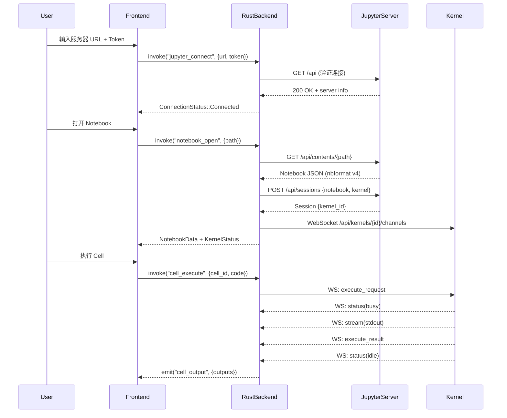

# LabNexus — Rust + Tauri 远程 JupyterLab 客户端 + Agent 系统方案

## 1. 项目定位

LabNexus 是一个基于 **Rust + Tauri v2** 构建的本地桌面应用，核心目标：

1. **连接远程 JupyterLab**：通过 Jupyter Server REST API + WebSocket Kernel 协议，在本地 GUI 中实现远程 Notebook 的浏览、编辑、执行
2. **集成 Agent 能力**：在本地嵌入 AI Agent，能够理解用户意图、操控 JupyterLab 中的 Notebook/Kernel、编排多步骤分析任务
3. **MCP/Skill/Knowledge 架构复用**：继承你在 smart-airquality 中已验证的 Agent 四层架构（Agent → MCP → Skill → Knowledge Base），但以 Rust 为核心重写

---

## 已确认的设计决策

| 决策项 | 确认结果 |
|--------|----------|
| 技术栈 | Tauri v2 + React (TypeScript) + Rust 后端 ✅ |
| LLM 推理 | **C) 混合模式**（远程 API 优先 + Ollama 本地 fallback）✅ |
| 多服务器 | ✅ 支持同时连接多个远程 JupyterLab 实例 |
| 领域知识 | **通用科学计算领域**（非空气污染专属）✅ |
| 离线编辑 | ✅ 本地缓存远程 Notebook，支持离线编辑 |
| 网络代理 | ✅ 支持 **SOCKS 代理** 和 **SSH -D 隧道**连接远程 Jupyter Server |

---

## 2. 系统总体架构

```
┌─────────────────────────────────────────────────────────────────────────────┐
│                              LabNexus Desktop                              │
│                          (Tauri v2 Application)                            │
│                                                                             │
│  ┌───────────────────────────────────────────────────────────────────────┐  │
│  │                     Frontend (WebView / React+TS)                     │  │
│  │                                                                       │  │
│  │  ┌──────────┐  ┌──────────┐  ┌──────────┐  ┌──────────┐  ┌────────┐ │  │
│  │  │ Notebook  │  │ Terminal  │  │  Agent   │  │ Explorer │  │Settings│ │  │
│  │  │  Editor   │  │  Panel   │  │  Chat    │  │  Panel   │  │ Panel  │ │  │
│  │  │(CodeMirror│  │(xterm.js)│  │          │  │          │  │        │ │  │
│  │  │  6)       │  │          │  │          │  │          │  │        │ │  │
│  │  └─────┬─────┘  └─────┬───┘  └─────┬────┘  └─────┬────┘  └───┬────┘ │  │
│  │        │               │            │             │            │       │  │
│  │  ──────┴───────────────┴────────────┴─────────────┴────────────┴───── │  │
│  │                        Tauri IPC Bridge (invoke / listen)             │  │
│  └───────────────────────────────────────────────────────────────────────┘  │
│                                    │                                         │
│  ┌───────────────────────────────────────────────────────────────────────┐  │
│  │                     Rust Backend (Tauri Core)                         │  │
│  │                                                                       │  │
│  │  ┌─────────────────────────────────────────────────────────────────┐  │  │
│  │  │                    Tauri Command Layer                           │  │  │
│  │  │  jupyter::*  │  agent::*  │  kernel::*  │  fs::*  │  config::*  │  │  │
│  │  └──────┬───────┴─────┬─────┴──────┬──────┴────┬────┴──────┬──────┘  │  │
│  │         │             │            │           │           │          │  │
│  │  ┌──────┴──────┐ ┌────┴────┐ ┌─────┴─────┐ ┌──┴───┐ ┌────┴─────┐   │  │
│  │  │  Jupyter    │ │  Agent  │ │  Kernel   │ │ Local│ │  Config  │   │  │
│  │  │  Client     │ │  Engine │ │  Manager  │ │  FS  │ │  Store   │   │  │
│  │  │             │ │         │ │           │ │      │ │          │   │  │
│  │  │ REST API    │ │ MCP     │ │ WebSocket │ │      │ │ SQLite   │   │  │
│  │  │ + Auth      │ │ Skill   │ │ ZMQ Proto │ │      │ │          │   │  │
│  │  │             │ │ KB      │ │           │ │      │ │          │   │  │
│  │  │             │ │ LLM     │ │           │ │      │ │          │   │  │
│  │  └──────┬──────┘ └────┬────┘ └─────┬─────┘ └──────┘ └──────────┘   │  │
│  │         │             │            │                                 │  │
│  └─────────┼─────────────┼────────────┼─────────────────────────────────┘  │
│            │             │            │                                      │
└────────────┼─────────────┼────────────┼──────────────────────────────────────┘
             │             │            │
             ▼             ▼            ▼
     ┌───────────┐  ┌────────────┐  ┌──────────────────┐
     │ Remote     │  │ LLM API    │  │ Remote Jupyter   │
     │ Jupyter    │  │ (OpenAI /  │  │ Kernel           │
     │ Server     │  │  Ollama /  │  │ (ZMQ over WS)    │
     │ REST API   │  │  llama.cpp)│  │                  │
     └───────────┘  └────────────┘  └──────────────────┘
```

---

## 3. 技术栈详细选型

### 3.1 核心框架

| 层级 | 技术 | 理由 |
|------|------|------|
| 桌面框架 | **Tauri v2** | Rust 原生后端，轻量（~5MB），安全沙箱，IPC 类型安全 |
| 前端框架 | **React 19 + TypeScript** | 生态成熟，与你现有 smart-airquality 前端技术栈一致 |
| 样式系统 | **Vanilla CSS + CSS Modules** | 最大灵活性，无依赖 |
| 代码编辑器 | **CodeMirror 6** | JupyterLab 自身使用的编辑器内核，Notebook Cell 渲染的最佳选择 |
| 终端模拟 | **xterm.js** | 远程终端的标准方案 |
| 构建工具 | **Vite 6** | Tauri v2 官方推荐的前端构建工具 |

### 3.2 Rust 后端核心 Crate

| Crate | 用途 | 版本 |
|-------|------|------|
| `tauri` | 桌面应用框架 | v2.x |
| `reqwest` | HTTP 客户端（Jupyter REST API），内置 SOCKS5 代理支持 | 0.12 |
| `tokio` | 异步运行时 | 1.x |
| `tokio-tungstenite` | WebSocket（Kernel 通信） | 0.24 |
| `tokio-socks` | SOCKS5 代理（SSH -D 隧道支持） | 0.5 |
| `serde` / `serde_json` | JSON 序列化 | 1.x |
| `sqlx` | 本地 SQLite（配置/知识库/会话持久化） | 0.8 |
| `uuid` | 消息 ID 生成 | 1.x |
| `async-openai` / 自定义 | LLM API 调用 | — |
| `tera` | 模板引擎（Skill prompt 渲染） | 1.x |
| `rust-bert` 或 HTTP 调用 | 本地推理 / 远程 LLM | — |

### 3.3 数据存储

| 存储 | 用途 | 位置 |
|------|------|------|
| SQLite | 连接配置、Agent 会话历史、知识库、Skill 注册表 | `~/.labnexus/data.db` |
| 文件系统 | 本地 Notebook 缓存、Agent 输出文件 | `~/.labnexus/cache/` |
| Tauri Store | 用户偏好设置（主题、快捷键等） | Tauri 内置 |

---

## 4. 模块详细设计

### 4.1 Jupyter Client 模块 — 远程连接核心

```
src-tauri/src/jupyter/
├── mod.rs              # 模块入口
├── client.rs           # JupyterClient 结构体 — HTTP 连接池 + 认证
├── auth.rs             # Token / Password / OAuth 认证策略
├── api/
│   ├── mod.rs
│   ├── contents.rs     # Contents API — 文件/Notebook CRUD
│   ├── kernels.rs      # Kernels API — 启动/停止/中断内核
│   ├── sessions.rs     # Sessions API — Notebook-Kernel 绑定
│   ├── terminals.rs    # Terminals API — 远程终端
│   └── nbconvert.rs    # NBConvert API — 格式转换
├── kernel/
│   ├── mod.rs
│   ├── connection.rs   # WebSocket 连接管理
│   ├── protocol.rs     # Jupyter Messaging Protocol (jupyter_client wire format)
│   ├── execution.rs    # 代码执行 + 结果收集
│   └── output.rs       # 输出类型解析（stream / display_data / execute_result / error）
└── types.rs            # Notebook / Cell / Output 等类型定义
```

#### 4.1.1 Jupyter Server REST API 映射

| Jupyter API | HTTP Method | Rust 函数 | 用途 |
|-------------|-------------|-----------|------|
| `/api/contents/{path}` | GET | `contents::get()` | 获取文件/目录内容 |
| `/api/contents/{path}` | PUT | `contents::save()` | 保存 Notebook |
| `/api/contents/{path}` | POST | `contents::create()` | 创建新文件 |
| `/api/contents/{path}` | DELETE | `contents::delete()` | 删除文件 |
| `/api/kernels` | GET | `kernels::list()` | 列出运行中的 Kernel |
| `/api/kernels` | POST | `kernels::start()` | 启动新 Kernel |
| `/api/kernels/{id}` | DELETE | `kernels::shutdown()` | 关闭 Kernel |
| `/api/kernels/{id}/interrupt` | POST | `kernels::interrupt()` | 中断执行 |
| `/api/kernels/{id}/restart` | POST | `kernels::restart()` | 重启 Kernel |
| `/api/sessions` | GET/POST | `sessions::*()` | Session 管理 |
| `/api/terminals` | GET/POST | `terminals::*()` | 终端管理 |

#### 4.1.2 Kernel WebSocket 协议

```rust
// Jupyter Wire Protocol Message
#[derive(Serialize, Deserialize)]
pub struct JupyterMessage {
    pub header: MessageHeader,
    pub parent_header: Option<MessageHeader>,
    pub metadata: serde_json::Value,
    pub content: serde_json::Value,
    pub buffers: Vec<Vec<u8>>,
}

#[derive(Serialize, Deserialize)]
pub struct MessageHeader {
    pub msg_id: String,        // UUID
    pub msg_type: String,      // "execute_request", "execute_reply", etc.
    pub username: String,
    pub session: String,       // UUID — 每个连接唯一
    pub date: String,          // ISO 8601
    pub version: String,       // "5.3"
}

// WebSocket 连接: ws://{server}/api/kernels/{kernel_id}/channels
// 消息类型:
//   Shell:    execute_request → execute_reply
//   IOPub:    stream, display_data, execute_result, error, status
//   Control:  interrupt_request, shutdown_request
//   Stdin:    input_request → input_reply
```

#### 4.1.3 连接生命周期



---

### 4.2 Agent Engine 模块 — AI 智能体核心

```
src-tauri/src/agent/
├── mod.rs              # 模块入口
├── engine.rs           # Agent 主循环（Think → Act → Observe）
├── context.rs          # 上下文管理（会话历史 + 注入知识 + 系统 prompt）
├── planner.rs          # 执行计划生成器
├── llm/
│   ├── mod.rs
│   ├── provider.rs     # LLM Provider trait 定义
│   ├── openai.rs       # OpenAI / 兼容 API 实现
│   ├── anthropic.rs    # Anthropic Claude 实现
│   ├── ollama.rs       # Ollama 本地推理
│   └── router.rs       # 智能路由（远程优先 → 本地 fallback）
├── mcp/
│   ├── mod.rs
│   ├── registry.rs     # 统一工具注册表
│   ├── jupyter_tools.rs  # Jupyter 操作工具（MCP 化）
│   ├── fs_tools.rs     # 文件系统工具
│   ├── external.rs     # 外部 MCP Server 连接
│   └── types.rs        # Tool / ToolCall / ToolResult 类型
├── skill/
│   ├── mod.rs
│   ├── registry.rs     # Skill 注册与匹配
│   ├── runtime.rs      # Skill 步骤执行引擎
│   ├── library.rs      # 预置 Skill 库
│   └── types.rs        # Skill / SkillStep / SkillRun 类型
├── knowledge/
│   ├── mod.rs
│   ├── store.rs        # 知识库存储（SQLite）
│   ├── retrieval.rs    # 知识检索（关键词 + 语义搜索）
│   └── types.rs        # KnowledgeEntry 类型
└── trace.rs            # Agent 执行追踪记录
```

#### 4.2.1 Agent 主循环

```rust
/// Agent 核心执行循环 — ReAct 模式
pub struct AgentEngine {
    llm: Box<dyn LlmProvider>,
    mcp: ToolRegistry,
    skills: SkillRegistry,
    knowledge: KnowledgeStore,
    max_iterations: usize,  // 防止无限循环，默认 10
}

impl AgentEngine {
    pub async fn run(&self, query: &str, ctx: &mut AgentContext) -> AgentResult {
        // Step 1: 知识检索 — 注入领域事实
        let knowledge = self.knowledge.retrieve(query).await?;
        ctx.inject_knowledge(&knowledge);

        // Step 2: Skill 匹配 — 检查是否有预定义流程
        let matched_skill = self.skills.match_query(query);
        if let Some(skill) = &matched_skill {
            ctx.inject_skill_plan(skill);
        }

        // Step 3: ReAct 主循环
        for iteration in 0..self.max_iterations {
            // Think: LLM 生成下一步行动
            let thought = self.llm.think(ctx).await?;

            match thought.action {
                Action::ToolCall(tool_call) => {
                    // Act: 执行工具调用
                    let result = self.mcp.execute(&tool_call).await?;
                    // Observe: 将结果加入上下文
                    ctx.add_observation(&tool_call, &result);
                }
                Action::FinalAnswer(answer) => {
                    // 输出最终答案
                    return Ok(AgentResult {
                        answer,
                        trace: ctx.get_trace(),
                        matched_skill,
                    });
                }
            }
        }

        Err(AgentError::MaxIterationsReached)
    }
}
```

#### 4.2.2 MCP 工具注册表 — Jupyter 操作工具化

Agent 与 JupyterLab 的交互通过 MCP 工具化暴露，使 Agent 能像调用任何其他工具一样操控 Notebook：

```rust
// Agent 可用的 Jupyter MCP 工具
pub fn register_jupyter_tools(registry: &mut ToolRegistry) {
    registry.register(Tool {
        name: "jupyter.cell.execute",
        description: "Execute a code cell in the active notebook kernel",
        parameters: json_schema!({
            "code": { "type": "string", "description": "Python code to execute" },
            "cell_index": { "type": "integer", "description": "Cell index (optional)" }
        }),
    });

    registry.register(Tool {
        name: "jupyter.cell.add",
        description: "Add a new cell to the notebook",
        parameters: json_schema!({
            "cell_type": { "type": "string", "enum": ["code", "markdown"] },
            "source": { "type": "string" },
            "position": { "type": "string", "enum": ["above", "below", "end"] }
        }),
    });

    registry.register(Tool {
        name: "jupyter.notebook.save",
        description: "Save the current notebook",
        parameters: json_schema!({}),
    });

    registry.register(Tool {
        name: "jupyter.file.read",
        description: "Read a file from the remote Jupyter file system",
        parameters: json_schema!({
            "path": { "type": "string" }
        }),
    });

    registry.register(Tool {
        name: "jupyter.kernel.restart",
        description: "Restart the current kernel",
        parameters: json_schema!({}),
    });

    registry.register(Tool {
        name: "jupyter.terminal.execute",
        description: "Execute a shell command in a remote terminal",
        parameters: json_schema!({
            "command": { "type": "string" }
        }),
    });
}
```

#### 4.2.3 预置 Skill 库

| Skill ID | 名称 | 工作流程 |
|----------|------|---------|
| `notebook.data_analysis` | 数据分析 | 读取数据 → 探索性分析 → 可视化 → 总结发现 |
| `notebook.debug_error` | 错误调试 | 读取错误 → 分析原因 → 搜索修复方案 → 应用修复 → 验证 |
| `notebook.code_review` | 代码审查 | 读取 Notebook → 逐 Cell 分析 → 提出改进建议 → 可选自动重构 |
| `notebook.environment_setup` | 环境配置 | 检查已安装包 → 分析依赖 → 安装缺失包 → 验证导入 |
| `notebook.report_generation` | 报告生成 | 收集执行结果 → 整理 Markdown Cell → 导出 PDF/HTML |
| `jupyter.server_health` | 服务器健康检查 | 检查连接 → 列出 Kernel → 检查资源占用 → 报告状态 |

---

### 4.3 前端模块设计

```
src/
├── App.tsx                  # 主应用入口
├── main.tsx                 # React 入口
├── index.css                # 全局设计系统（CSS 变量 + 主题）
├── layouts/
│   └── WorkbenchLayout.tsx  # IDE 风格主布局（侧边栏 + 编辑区 + 面板）
├── components/
│   ├── notebook/
│   │   ├── NotebookEditor.tsx    # Notebook 主编辑器
│   │   ├── Cell.tsx              # 单个 Cell（Code/Markdown/Raw）
│   │   ├── CellInput.tsx         # CodeMirror 6 代码输入区
│   │   ├── CellOutput.tsx        # 输出渲染（文本/HTML/图片/表格）
│   │   ├── CellToolbar.tsx       # Cell 工具栏（运行/删除/移动）
│   │   └── KernelStatus.tsx      # Kernel 状态指示器
│   ├── explorer/
│   │   ├── FileExplorer.tsx      # 远程文件浏览器
│   │   ├── FileTree.tsx          # 文件树组件
│   │   └── ConnectionPanel.tsx   # 服务器连接管理面板
│   ├── agent/
│   │   ├── AgentChat.tsx         # Agent 聊天面板
│   │   ├── AgentMessage.tsx      # 消息气泡（支持 Markdown + 代码块）
│   │   ├── AgentInput.tsx        # 用户输入框
│   │   ├── AgentTrace.tsx        # 执行追踪可视化
│   │   └── SkillSelector.tsx     # Skill 选择器
│   ├── terminal/
│   │   └── TerminalPanel.tsx     # xterm.js 远程终端
│   ├── settings/
│   │   ├── SettingsPanel.tsx     # 设置面板
│   │   ├── LlmSettings.tsx      # LLM 配置（API Key、模型选择）
│   │   └── JupyterSettings.tsx  # Jupyter 连接配置
│   └── common/
│       ├── SplitPane.tsx         # 可拖拽分割面板
│       ├── TabBar.tsx            # 标签栏
│       ├── StatusBar.tsx         # 底部状态栏
│       └── Sidebar.tsx           # 侧边栏导航
├── hooks/
│   ├── useJupyter.ts             # Jupyter 连接状态管理
│   ├── useKernel.ts              # Kernel 状态 + 执行
│   ├── useNotebook.ts            # Notebook 文档状态
│   ├── useAgent.ts               # Agent 交互
│   └── useTheme.ts               # 主题切换
├── services/
│   ├── tauriIpc.ts               # Tauri IPC 调用封装
│   ├── jupyterService.ts         # Jupyter 相关 IPC 封装
│   └── agentService.ts           # Agent 相关 IPC 封装
└── types/
    ├── jupyter.ts                # Notebook / Cell / Output 类型
    ├── agent.ts                  # Agent / Tool / Skill 类型
    └── common.ts                 # 通用类型
```

---

## 5. Tauri IPC 接口设计

### 5.1 Jupyter 连接命令

```rust
// src-tauri/src/commands/jupyter.rs

#[tauri::command]
async fn jupyter_connect(
    state: State<'_, AppState>,
    url: String,
    token: String,
) -> Result<ServerInfo, JupyterError>;

#[tauri::command]
async fn jupyter_disconnect(
    state: State<'_, AppState>,
) -> Result<(), JupyterError>;

#[tauri::command]
async fn jupyter_list_contents(
    state: State<'_, AppState>,
    path: String,
) -> Result<Vec<ContentItem>, JupyterError>;

#[tauri::command]
async fn notebook_open(
    state: State<'_, AppState>,
    path: String,
) -> Result<NotebookDocument, JupyterError>;

#[tauri::command]
async fn notebook_save(
    state: State<'_, AppState>,
    path: String,
    content: NotebookDocument,
) -> Result<(), JupyterError>;

#[tauri::command]
async fn cell_execute(
    state: State<'_, AppState>,
    code: String,
) -> Result<String, JupyterError>;
// 注意: 实际执行结果通过 Tauri Event 异步推送
```

### 5.2 Tauri Events（后端 → 前端推送）

```typescript
// 前端监听的事件
interface TauriEvents {
  // Kernel 输出事件
  "kernel:output": {
    msg_type: "stream" | "display_data" | "execute_result" | "error";
    cell_id: string;
    content: OutputContent;
  };

  // Kernel 状态变更
  "kernel:status": {
    status: "idle" | "busy" | "starting" | "restarting";
  };

  // Agent 流式响应
  "agent:stream": {
    chunk_type: "thought" | "action" | "observation" | "answer";
    content: string;
  };

  // Agent 工具调用
  "agent:tool_call": {
    tool_name: string;
    parameters: Record<string, unknown>;
    result?: string;
    status: "pending" | "running" | "completed" | "error";
  };

  // 连接状态
  "jupyter:connection": {
    status: "connected" | "disconnected" | "reconnecting" | "error";
    message?: string;
  };
}
```

### 5.3 Agent 命令

```rust
// src-tauri/src/commands/agent.rs

#[tauri::command]
async fn agent_chat(
    state: State<'_, AppState>,
    window: Window,
    message: String,
    context: Option<AgentChatContext>,  // 可附带当前 Notebook 上下文
) -> Result<(), AgentError>;
// Agent 响应通过 "agent:stream" 事件异步推送

#[tauri::command]
async fn agent_stop(
    state: State<'_, AppState>,
) -> Result<(), AgentError>;

#[tauri::command]
async fn agent_list_tools(
    state: State<'_, AppState>,
) -> Result<Vec<ToolInfo>, AgentError>;

#[tauri::command]
async fn agent_list_skills(
    state: State<'_, AppState>,
) -> Result<Vec<SkillInfo>, AgentError>;

#[tauri::command]
async fn agent_get_history(
    state: State<'_, AppState>,
    session_id: Option<String>,
) -> Result<Vec<AgentMessage>, AgentError>;
```

---

## 6. Agent 与 Jupyter 的协同工作流

### 6.1 典型交互示例

```
用户输入："帮我分析 data/experiment.csv 的数据分布，画出直方图"

┌─── Agent 接收 ────────────────────────────────────────────────────┐
│                                                                    │
│  Step 1: 知识检索                                                  │
│  ├─ (无特定领域知识匹配)                                            │
│                                                                    │
│  Step 2: Skill 匹配                                                │
│  ├─ 匹配到: notebook.data_analysis (数据分析)                       │
│  └─ 工作流:                                                        │
│       ① 读取数据文件                                                │
│       ② 探索性分析 (describe, info, head)                           │
│       ③ 生成可视化                                                  │
│       ④ 总结发现                                                    │
│                                                                    │
│  Step 3: 按 Skill 步骤执行                                         │
│                                                                    │
│  ┌─── 步骤 ① ─── MCP: jupyter.cell.execute ──────────────┐         │
│  │  code: "import pandas as pd\n                          │         │
│  │         df = pd.read_csv('data/experiment.csv')\n      │         │
│  │         print(f'Shape: {df.shape}')\n                  │         │
│  │         df.head()"                                     │         │
│  │  → 返回: Shape: (1000, 8), 前5行数据                    │         │
│  └────────────────────────────────────────────────────────┘         │
│                                                                    │
│  ┌─── 步骤 ② ─── MCP: jupyter.cell.execute ──────────────┐         │
│  │  code: "df.describe()"                                 │         │
│  │  → 返回: 统计摘要表                                     │         │
│  └────────────────────────────────────────────────────────┘         │
│                                                                    │
│  ┌─── 步骤 ③ ─── MCP: jupyter.cell.execute ──────────────┐         │
│  │  code: "import matplotlib.pyplot as plt\n              │         │
│  │         fig, axes = plt.subplots(2, 4, figsize=(16,8))\n │       │
│  │         for i, col in enumerate(df.columns):\n         │         │
│  │             df[col].hist(ax=axes[i//4][i%4])\n         │         │
│  │         plt.tight_layout()\n                           │         │
│  │         plt.show()"                                    │         │
│  │  → 返回: display_data (PNG 图片)                        │         │
│  └────────────────────────────────────────────────────────┘         │
│                                                                    │
│  ┌─── 步骤 ④ ─── Agent 总结 ─────────────────────────────┐         │
│  │  基于步骤 ①②③ 的结果，生成分析总结:                      │         │
│  │  "数据集包含 1000 行 × 8 列，其中...                     │         │
│  │   column_a 呈正态分布，column_b 有右偏..."               │         │
│  └────────────────────────────────────────────────────────┘         │
│                                                                    │
│  Agent 输出: 结构化分析 + Notebook 中已自动创建 3 个新 Cell          │
│                                                                    │
└────────────────────────────────────────────────────────────────────┘
```

### 6.2 Agent 上下文感知

Agent 能感知当前 Notebook 的完整状态，在对话中自动注入：

```rust
#[derive(Serialize)]
pub struct AgentChatContext {
    // 当前 Notebook 信息
    pub notebook_path: Option<String>,
    pub notebook_cells: Vec<CellSummary>,  // Cell 类型 + 前 N 行代码
    pub kernel_status: KernelStatus,
    pub kernel_language: String,           // "python", "r", "julia"

    // 当前选中的 Cell
    pub active_cell_index: Option<usize>,
    pub active_cell_source: Option<String>,
    pub active_cell_output: Option<String>,

    // Kernel 变量空间（可选，通过 inspect_request 获取）
    pub variables: Option<Vec<VariableInfo>>,

    // 最近的错误
    pub last_error: Option<String>,
}
```

---

## 7. 项目目录结构

```
labnexus/
├── src-tauri/                          # Rust 后端
│   ├── Cargo.toml
│   ├── tauri.conf.json                 # Tauri 配置
│   ├── capabilities/                   # Tauri v2 权限配置
│   │   └── default.json
│   ├── icons/                          # 应用图标
│   ├── src/
│   │   ├── main.rs                     # 入口
│   │   ├── lib.rs                      # 库入口 + Tauri Builder 配置
│   │   ├── state.rs                    # AppState 全局状态
│   │   ├── error.rs                    # 统一错误类型
│   │   ├── commands/                   # Tauri 命令（IPC 入口）
│   │   │   ├── mod.rs
│   │   │   ├── jupyter.rs
│   │   │   ├── agent.rs
│   │   │   └── config.rs
│   │   ├── jupyter/                    # Jupyter Client 模块
│   │   │   ├── mod.rs
│   │   │   ├── client.rs
│   │   │   ├── auth.rs
│   │   │   ├── api/
│   │   │   │   ├── mod.rs
│   │   │   │   ├── contents.rs
│   │   │   │   ├── kernels.rs
│   │   │   │   ├── sessions.rs
│   │   │   │   └── terminals.rs
│   │   │   ├── kernel/
│   │   │   │   ├── mod.rs
│   │   │   │   ├── connection.rs
│   │   │   │   ├── protocol.rs
│   │   │   │   ├── execution.rs
│   │   │   │   └── output.rs
│   │   │   └── types.rs
│   │   ├── agent/                      # Agent Engine 模块
│   │   │   ├── mod.rs
│   │   │   ├── engine.rs
│   │   │   ├── context.rs
│   │   │   ├── planner.rs
│   │   │   ├── llm/
│   │   │   │   ├── mod.rs
│   │   │   │   ├── provider.rs
│   │   │   │   ├── openai.rs
│   │   │   │   ├── anthropic.rs
│   │   │   │   ├── ollama.rs
│   │   │   │   └── router.rs
│   │   │   ├── mcp/
│   │   │   │   ├── mod.rs
│   │   │   │   ├── registry.rs
│   │   │   │   ├── jupyter_tools.rs
│   │   │   │   ├── fs_tools.rs
│   │   │   │   └── types.rs
│   │   │   ├── skill/
│   │   │   │   ├── mod.rs
│   │   │   │   ├── registry.rs
│   │   │   │   ├── runtime.rs
│   │   │   │   └── library.rs
│   │   │   ├── knowledge/
│   │   │   │   ├── mod.rs
│   │   │   │   ├── store.rs
│   │   │   │   └── retrieval.rs
│   │   │   └── trace.rs
│   │   └── db/                         # 数据库
│   │       ├── mod.rs
│   │       ├── migrations/
│   │       └── models.rs
│   └── migrations/                     # SQLite 迁移脚本
│       ├── 001_init.sql
│       └── 002_knowledge.sql
│
├── src/                                # 前端 (React + TypeScript)
│   ├── App.tsx
│   ├── main.tsx
│   ├── index.css                       # 设计系统
│   ├── layouts/
│   ├── components/
│   │   ├── notebook/
│   │   ├── explorer/
│   │   ├── agent/
│   │   ├── terminal/
│   │   ├── settings/
│   │   └── common/
│   ├── hooks/
│   ├── services/
│   └── types/
│
├── index.html                          # HTML 入口
├── package.json                        # 前端依赖
├── tsconfig.json
├── vite.config.ts                      # Vite 配置
└── README.md
```

---

## 8. 实施路线

### Phase 1: 项目脚手架 + Jupyter 连接（3-4 天）

**目标**：搭建 Tauri v2 项目骨架，实现远程 Jupyter Server 的基本连接和文件浏览。

| 任务 | 产出 |
|------|------|
| 初始化 Tauri v2 + React + Vite 项目 | 可运行的空壳桌面应用 |
| 实现 `JupyterClient`（REST API 封装） | 连接/断开、认证、服务器信息 |
| 实现 Contents API | 远程文件浏览、Notebook 读取 |
| 前端：连接面板 + 文件浏览器 | 可视化浏览远程文件系统 |

### Phase 2: Notebook 编辑 + Kernel 执行（4-5 天）

**目标**：实现 Notebook 的完整编辑和执行体验。

| 任务 | 产出 |
|------|------|
| 实现 Kernel WebSocket 连接和消息协议 | 代码执行基础设施 |
| 实现 Cell 输出解析（text/HTML/image/error） | 富输出渲染 |
| 前端：CodeMirror 6 集成 + Cell 编辑器 | 代码高亮编辑 |
| 前端：Notebook 渲染 + Cell 执行 UI | 完整 Notebook 交互 |
| 前端：Kernel 状态指示 + 中断/重启控制 | Kernel 生命周期管理 |

### Phase 3: Agent 核心引擎（4-5 天）

**目标**：实现 Agent 的 ReAct 循环和 LLM 集成。

| 任务 | 产出 |
|------|------|
| 实现 `LlmProvider` trait + OpenAI 实现 | LLM 调用基础 |
| 实现 `ToolRegistry` + Jupyter 工具注册 | Agent 可操控 Jupyter |
| 实现 `AgentEngine` ReAct 主循环 | 思考→行动→观察循环 |
| 实现 Agent 上下文管理（Notebook 感知） | 上下文注入 |
| 前端：Agent 聊天面板 + 流式响应 | Agent 交互 UI |

### Phase 4: Skill + Knowledge + MCP 扩展（3-4 天）

**目标**：补齐 Agent 四层架构。

| 任务 | 产出 |
|------|------|
| 实现 `SkillRegistry` + 预置 Skill | 多步骤任务编排 |
| 实现 `KnowledgeStore`（SQLite） | 领域知识注入 |
| 实现外部 MCP Server 连接（stdio transport） | 可扩展工具生态 |
| Agent 执行追踪（trace） | 可审计的执行历史 |

### Phase 5: 打磨 + 进阶功能（3-4 天）

**目标**：完善用户体验和高级功能。

| 任务 | 产出 |
|------|------|
| 远程终端（xterm.js） | 完整终端体验 |
| 多标签 Notebook 编辑 | 多文件工作流 |
| 主题系统（暗色/亮色） | 视觉体验 |
| Ollama 本地推理集成 | 离线 Agent 能力 |
| 设置面板（LLM 配置、Jupyter 服务器管理） | 用户配置 |
| 应用打包和分发 | 可安装的桌面应用 |

**总预估：17-22 天**

---

## 9. 验证计划

### 自动化测试

```bash
# Rust 单元测试
cargo test --workspace

# Rust 集成测试（需要 mock Jupyter server）
cargo test --test integration

# 前端组件测试
npm run test

# E2E 测试（Tauri + WebDriver）
cargo tauri test
```

### 手动验证

| 场景 | 验证步骤 |
|------|---------|
| Jupyter 连接 | 1. 输入远程 URL + Token → 2. 验证连接成功 → 3. 浏览文件树 |
| Notebook 执行 | 1. 打开 .ipynb → 2. 编辑 Cell → 3. 执行 → 4. 查看输出 |
| Agent 对话 | 1. 输入自然语言指令 → 2. 观察 Agent 自动执行 Cell → 3. 查看追踪 |
| Skill 编排 | 1. 触发数据分析 Skill → 2. 验证多步骤自动执行 → 3. 查看报告 |
| 离线回退 | 1. 断开网络 → 2. 验证 Ollama 本地推理可用 |

---

## 10. 关键设计决策总结

| 决策点 | 选择 | 理由 |
|--------|------|------|
| 桌面框架 | Tauri v2 而非 Electron | 包体小（~5MB vs ~100MB），内存低，Rust 安全性 |
| Kernel 通信 | WebSocket 而非 ZMQ | 浏览器兼容，Jupyter Server 已提供 WS 代理 |
| Agent 架构 | ReAct 循环 | 与你已验证的 Think→Act→Observe 模式一致 |
| 工具化方式 | MCP 协议 | 与 smart-airquality 架构对齐，可复用外部 MCP Server |
| 代码编辑器 | CodeMirror 6 | JupyterLab 原生编辑器内核，支持 Notebook 场景 |
| 数据存储 | SQLite (sqlx) | 单文件数据库，零配置，适合桌面应用 |
| LLM 策略 | 混合模式 | 远程 API 优先 + 本地 Ollama fallback |
